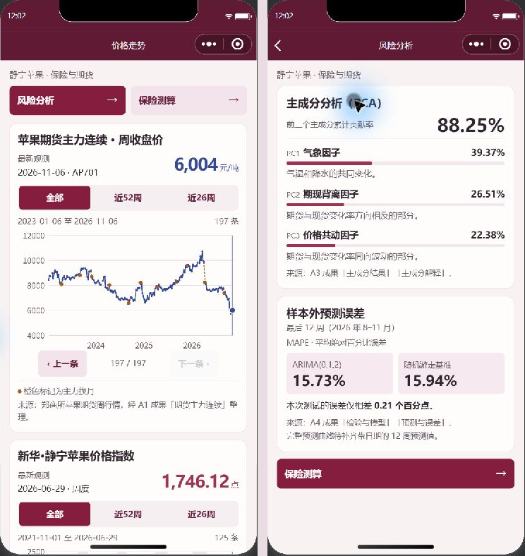

# Apple Price Insurance · 静宁苹果保险与期货

原生微信小程序，用于查看苹果期货价格、静宁苹果现货指数，以及项目的风险分析结果。

## 本地运行

1. 打开微信开发者工具，选择导入项目。
2. 选择含 `project.config.json` 的仓库根目录，点击编译。
3. 本地模拟器可使用项目自带的测试 AppID `touristappid`。真机预览需使用有开发权限的小程序 AppID。

小程序直接读取随项目打包的 JSON 数据，无需安装 npm 依赖或启动后端。

## 页面

| 页面 | 功能 |
| --- | --- |
| 价格走势 | 查看期货周收盘价与现货指数，支持全部、近 52 周、近 26 周，点图或逐条查看。期货图标出主力换月，现货图区分月度、周度和长缺口。 |
| 风险分析 | 展示 PCA 主成分贡献率，以及 ARIMA 与随机游走基准的样本外预测误差。 |
| 保险测算 | 已接入导航，三档保障方案的测算功能待实现。 |

## 数据来源

- `miniprogram/data/prices.json` 中的期货序列来自郑商所苹果期货周行情，经项目 A1 成果的「期货主力连续」整理，共 197 条，单位为元/吨。
- 同一文件中的现货序列来自新华·中国（静宁）苹果价格指数的「指数点位(精确)」，共 125 条，单位为点。展示数据将 2026-03-02 的 2744.39 点校正为 1892.44 点。
- `miniprogram/data/risk.json` 中的 PCA 和 ARIMA 指标来自项目 A3、A4 成果。样本外测试区间为最后 12 周（2026 年 8–11 月）。完整预测曲线待补齐带日期的 12 周预测值。

## 代码结构

- `miniprogram/pages/` 中的 `price`、`risk`、`insurance` 对应三个页面。
- `miniprogram/components/price-chart/` 是价格图组件，负责绘图、时间范围切换和观测值选择。
- `miniprogram/data/` 保存小程序运行所需的数据快照。
